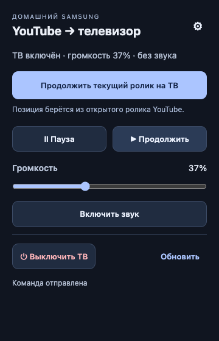

# YouTube Home Assistant TV

[](https://github.com/meshchaninov/youtube-home-assistant-tv/actions/workflows/checks.yml)

Продолжить ролик YouTube с компьютера на Samsung Smart TV — через Home Assistant. Расширение для **Chrome и Brave**, Manifest V3.

Нажмите **«Продолжить текущий ролик на ТВ»**: расширение возьмёт позицию из открытого видео, поставит его на компьютере на паузу и вызовет сценарий Home Assistant. Сценарий включит телевизор, дождётся Wi-Fi и запустит YouTube с переданной секунды.



## Возможности

- Передача обычных роликов и Shorts с текущей позиции.
- Ожидание появления включённого ТВ в Home Assistant до 120 секунд.
- Повторная отправка того же ролика после перемотки на компьютере, включая возврат к `0:00`.
- Пауза, продолжение, выключение телевизора и переключение звука.
- Ползунок громкости **0–100%**: запрос отправляется после отпускания.
- Пульт работает с любой вкладки; отправка ролика требует страницы YouTube.
- Локальное хранение настроек без синхронизации токена между браузерами.

## Как устроено

```text
Chrome / Brave
  ├─ активная страница YouTube → video ID + текущая секунда
  └─ Home Assistant WebSocket API
       ├─ script.samsung_youtube_handoff
       │    ├─ включение ТВ → ожидание доступности → выбор YouTube
       │    └─ Python → YouTube Lounge → выбор ролика + seekTo + play
       └─ script.samsung_youtube_remote
            └─ штатные команды Samsung: воспроизведение, звук, питание
```

Расширение обращается только к Home Assistant. Обработчик на сервере получает DIAL screen ID у телевизора и отправляет команды в API YouTube. Нужен доступ к YouTube с телевизора и сервера.

## Требования

- Chrome или Brave на Chromium 116 и новее.
- Home Assistant со штатной интеграцией Samsung Smart TV.
- Телевизор с приложением YouTube и DIAL endpoint `http://TV_IP:8080/ws/app/YouTube`.
- Рабочая команда включения телевизора: Wake-on-LAN или отдельный ИК-пульт.
- Python внутри окружения HA с пакетами `requests` и `casttube`.

Проверялось с Samsung UE43M5503. Совместимость со всеми моделями Samsung не заявляется. YouTube Lounge — неофициальный протокол и может меняться.

## 1. Настройка Home Assistant

Все адреса и entity ID в репозитории — **примеры**, их нужно заменить перед использованием.

| Где | Что заменить |
| --- | --- |
| `home-assistant/youtube_handoff.py` | `TV_HOST = "192.0.2.10"` → IP вашего телевизора |
| `home-assistant/script.yaml` | `media_player.samsung_tv` → сущность вашего ТВ |
| `home-assistant/remote-script.yaml` | `media_player.samsung_tv` → та же сущность ТВ |
| `extension/background.js` | `TV_ENTITY = 'media_player.samsung_tv'` → та же сущность ТВ |
| `home-assistant/script.yaml`, необязательно | `remote.tv_ir` → сущность вашего ИК-пульта |

1. Сохраните резервную копию конфигурации HA.
2. Скопируйте `home-assistant/youtube_handoff.py` в `/config/helpers/youtube_handoff.py`.
3. Добавьте содержимое **обоих** файлов `script.yaml` и `remote-script.yaml` в `/config/scripts.yaml`. Они задают разные сценарии.
4. Добавьте содержимое `home-assistant/shell-command.yaml` **внутрь существующего** раздела `shell_command:` в `configuration.yaml`. Если раздела нет, создайте его. Не создавайте второй раздел с тем же ключом.
5. Проверьте конфигурацию HA. Перезагрузите сценарии через `script.reload` и команды через `shell_command.reload`. Если версия HA не поддерживает последнее действие, перезапустите HA.

Ожидаемая структура `configuration.yaml`:

```yaml
script: !include scripts.yaml
shell_command:
  samsung_youtube_handoff: >-
    python3 /config/helpers/youtube_handoff.py {{ video_id }} {{ position | int }}
```

В скрипте есть необязательная дискретная ИК-команда Samsung Power On `samsung32:addr=0x07,cmd=0x99`. Она вызывается только при наличии сущности `remote.tv_ir`. Это формат для совместимого Tuya IR remote; если ваш пульт принимает другие команды, замените ИК-действие или удалите его. Штатное `media_player.turn_on` и ожидание появления ТВ сохраняются.

Зависимости устанавливаются **в Python-окружение, в котором HA выполняет `shell_command`**. `requirements.txt` описывает необходимые пакеты. Установка на компьютере с браузером не установит их на сервере HA. Ручные изменения контейнера могут исчезнуть после обновления образа; для постоянной установки включите зависимости в свой образ/окружение. В HA OS нужно заранее проверить доступность этих библиотек и используемый способ установки.

Пример проверки внутри контейнера HA:

```sh
docker exec homeassistant python -c 'import requests, casttube; print("Dependencies available")'
```

## 2. Установка расширения

1. Скачайте или клонируйте репозиторий.
2. Замените `TV_ENTITY` в `extension/background.js`, как указано выше.
3. Откройте `chrome://extensions` или `brave://extensions`.
4. Включите **режим разработчика** → **Загрузить распакованное расширение** → выберите папку `extension`.
5. В открывшихся настройках укажите адрес Home Assistant и отдельный долгосрочный токен.
6. Оставьте имя скрипта `samsung_youtube_handoff`, если не переименовывали его. Нажмите **«Сохранить и разрешить доступ»**, затем **«Проверить связь»**.
7. Закрепите значок расширения на панели браузера.

Токен создаётся в Home Assistant: **профиль → Безопасность → Долгосрочные токены доступа**. Не добавляйте его в исходники, скриншоты или Git. Для Chrome и Brave настройку подключения нужно выполнить отдельно.

При использовании домашнего HTTPS-сертификата браузер должен доверять вашему CA. HTTP подходит только для доверенной сети: при нём токен передаётся без шифрования.

## Использование

Откройте ролик YouTube, дождитесь окончания рекламы, откройте пульт и нажмите кнопку отправки. Позиция фиксируется в момент отправки и не увеличивается на время включения телевизора.

Если перемотать тот же ролик на компьютере и отправить его повторно, телевизор перейдёт на новую позицию. Кнопка **«Продолжить»** в нижней части пульта просто продолжает воспроизведение на ТВ и не считывает позицию компьютера.

Громкость и состояние ТВ обновляются при открытии пульта и каждые 10 секунд, пока он открыт. Пульт блокируется, пока ТВ недоступен или выполняется команда. Отправка ролика остаётся доступной для включения ТВ. Закрытие окна пульта не отменяет уже начатый запуск.

На значке: `…` — выполнение, `✓` — команда принята, `!` — ошибка. Подробности отображаются в пульте. Успешный ответ API подтверждает команду, а не визуально проверенное воспроизведение.

## Ограничения

- Прямые трансляции, страницы без загруженного видео и ролик во время рекламы не отправляются.
- Передаётся один ролик без плейлиста; используется аккаунт YouTube на телевизоре.
- Кнопок относительной перемотки на ТВ пока нет: для них нужен надёжный снимок текущей позиции. Повторная отправка абсолютной позиции с компьютера поддерживается.
- При сетевом обрыве команда уже могла выполниться. Проверьте ТВ перед повторной отправкой.
- Обработчик повторяет только безопасные запросы установки сессии. Команды запуска и перемотки не повторяются автоматически после неоднозначного тайм-аута.
- Токен хранится в `chrome.storage.local`, без синхронизации. Это не зашифрованный менеджер паролей; используйте отдельный отзываемый токен.

## Разработка и проверки

Node.js 22+ и Python 3.12+:

```sh
node --test tests/*.test.mjs
python -m pip install -r requirements.txt
python tests/youtube_handoff_test.py
```

GitHub Actions запускает эти тесты и проверяет синтаксис JavaScript/Python и примеры YAML. Для проверки реального ТВ нужны ваша конфигурация HA, доступ к сети и физическая проверка. Тесты не используют реальные токены и не управляют устройствами.

В `extension/` нет сборки и удалённых скриптов: браузер загружает исходники напрямую.

## Обновление

Сохраните собственные адреса и entity ID перед обновлением, затем обновите соответствующие файлы на сервере и в папке расширения. После изменения YAML проверьте конфигурацию и перезагрузите сценарии. После изменения расширения нажмите кнопку перезагрузки на его карточке в Chrome/Brave. При обновлении в той же папке настройки подключения сохраняются.

## Источники протокола и API

- [Home Assistant Samsung Smart TV](https://www.home-assistant.io/integrations/samsungtv/)
- [Home Assistant WebSocket API](https://developers.home-assistant.io/docs/api/websocket/)
- [casttube](https://github.com/ur1katz/casttube)
- [YouTube Lounge commands](https://github.com/bertybuttface/youtube-lounge-rs)
